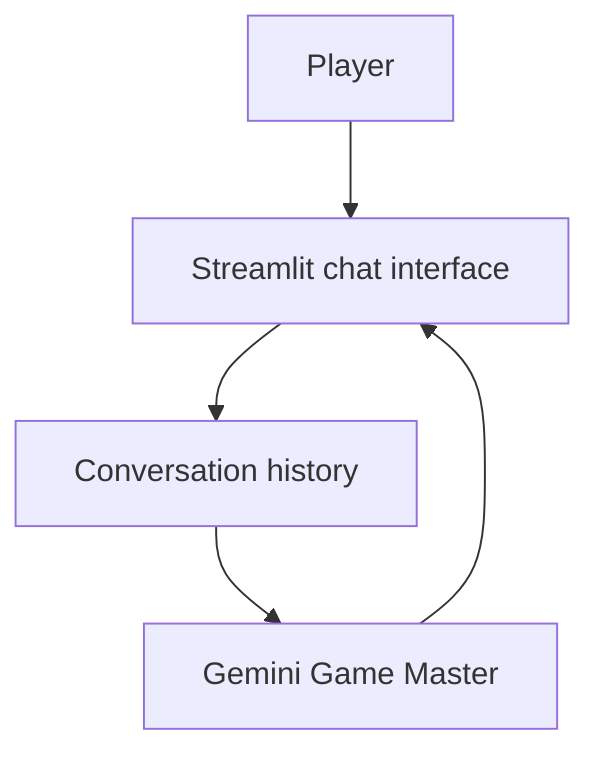
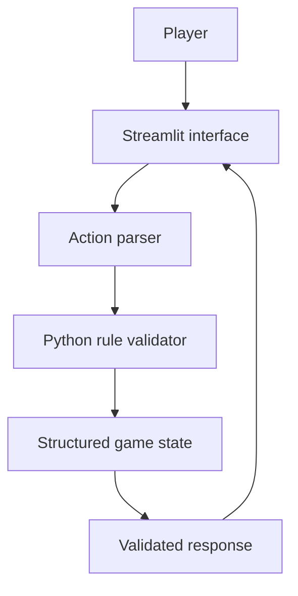

# System Architecture

## Version 1 — LLM-led

The model interprets player actions and narrates game progress. This is flexible but may forget state or invent outcomes.

## Version 2 — Python-led

Python decides whether actions are valid and updates state. The response is generated only after validation. This separation reduces hallucinated game progress.
