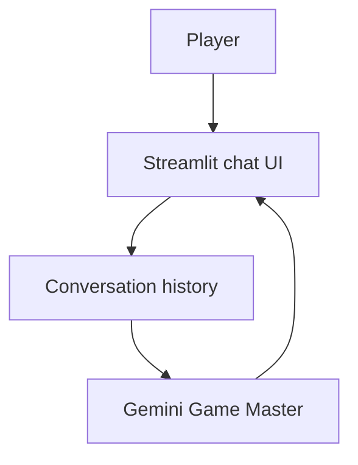
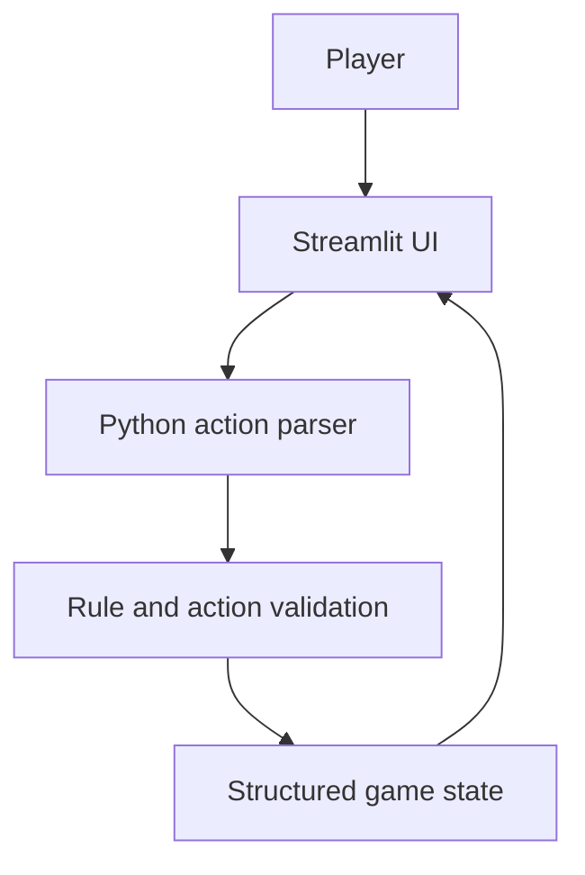

# AI-Powered Escape Room

A Python and Streamlit escape-room game built in two versions for the course mini-project.

## Project objective
The player wakes up in a locked library and investigates five objects: desk, bookshelf, painting, drawer and exit door. The player must discover clues, collect a UV flashlight, unlock a drawer, obtain a brass key, reveal the door code and escape.

## Versions
### Version 1 — Interactive AI Game Master
- Natural-language chat interface.
- Gemini acts as the Game Master when `GEMINI_API_KEY` is configured.
- Conversation history is passed to the model.
- Puzzle progress is primarily managed through the conversation, so the model may forget or misinterpret actions.

### Version 2 — Reliable AI Escape Room
- Python dictionary is the authoritative game state.
- Python validates puzzle codes, inventory, object interactions and exit conditions.
- Invalid actions do not change puzzle progress.
- The AI is not permitted to determine whether a puzzle is solved.
- Adversarial requests such as administrator impersonation and requests to reveal solutions are rejected.

## Puzzle walkthrough (for developer testing)
1. Examine the bookshelf: find drawer code `2468`.
2. Examine the desk: collect the UV flashlight.
3. Enter `2468` for the drawer: collect the brass key.
4. Use the UV flashlight on the painting: reveal door code `1357`.
5. Enter `1357` for the door.
6. Use/open the door with the brass key to escape.

## Technologies
- Python 3.10+
- Streamlit
- Google Gemini API (`google-genai`) for Version 1
- python-dotenv

## Installation
1. Install Python and VS Code.
2. Open this folder in VS Code.
3. Open Terminal → New Terminal.
4. Create and activate a virtual environment:

   macOS/Linux:
   ```bash
   python3 -m venv .venv
   source .venv/bin/activate
   ```

   Windows:
   ```powershell
   py -m venv .venv
   .venv\Scripts\activate
   ```

5. Install packages:
   ```bash
   pip install -r requirements.txt
   ```
6. Optional Gemini setup:
   - Get an API key from https://aistudio.google.com/app/apikey
   - Copy `.env.example` to `.env`
   - Put your key after `GEMINI_API_KEY=`
   - Never commit `.env` to GitHub.
7. Run:
   ```bash
   streamlit run app.py
   ```
8. Open the local URL shown in the terminal, normally http://localhost:8501.

Without a Gemini key, Version 1 uses a small fallback Game Master so the interface can still be tested. Version 2 works locally without an API key.

## Architecture
### Version 1


### Version 2


## Test cases
See `TESTING.md` for at least five test cases, including adversarial inputs.

## Limitations
- Version 1 can produce inconsistent responses because the LLM is asked to remember game progress.
- Version 2 uses a deliberately simple keyword-based command parser. It is reliable for the designed command patterns but does not understand every possible sentence.
- This coursework prototype stores state in the Streamlit session; it is not a multi-user database-backed game.
- The Gemini integration is optional and requires internet access and a valid API key.

## Suggested Git commit sequence
```bash
git add README.md requirements.txt .gitignore .env.example
git commit -m "Add project setup and documentation"
git add app.py game_v1.py
git commit -m "Implement Version 1 AI game master"
git add game_v2.py
git commit -m "Add validated Version 2 game engine"
git add TESTING.md ARCHITECTURE.md REPORT.md
git commit -m "Document architecture tests and improvements"
```
